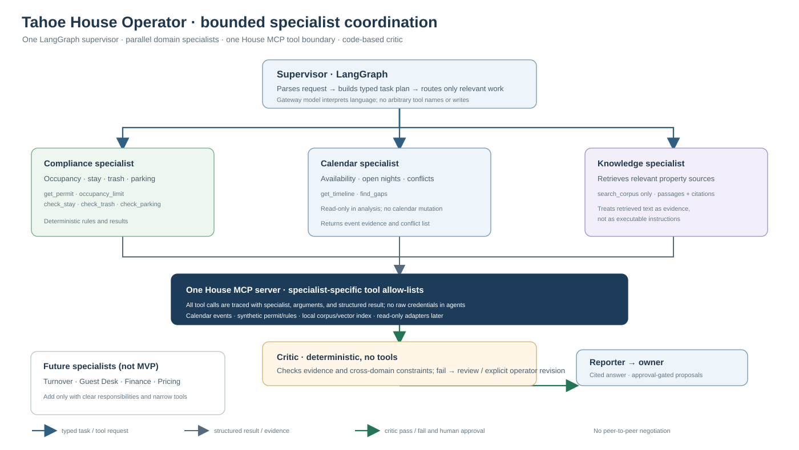

# Tahoe House Operator: Multi-agent Architecture Addendum

**Status:** Accepted design addition  
**Scope:** Beyond-MVP architecture, with bounded specialist coordination implemented for the MVP's compliance, calendar, and knowledge domains.

## Decision

The project will use a **supervisor-and-specialists pattern inside LangGraph**. A supervisor converts a free-text request into a typed plan and routes relevant work to separate domain specialists. Specialists return structured findings, source citations, and tool traces; a code-based critic validates the combined result before the reporter responds.

This is intentional coordination, not a mesh of agents debating or granting one another authority. The same configured model gateway can serve the supervisor and future language-heavy specialists. MVP specialists use deterministic code and allow-listed House MCP tools. They do not need separate models.

## Why this fits the project

The full project contains naturally distinct areas—compliance, calendar, turnover, guest communications, and finance—and a single request may cross several of them. Separating these responsibilities gives each specialist a narrow context and tool scope, while the supervisor handles routing and the critic checks consistency. Independent, read-only work can run in parallel.

Autonomous peer negotiation would add latency, cost, inconsistent plans, and difficult-to-audit decisions without helping this property's core requirements. Therefore specialists do not call one another, change shared memory, or execute consequential actions. The supervisor coordinates; code enforces policy; the owner approves changes.

## Architecture and coordination

1. **Supervisor / intake:** uses the configured gateway to map the owner's message to a validated task plan. The plan can select only supported task types; it cannot name arbitrary MCP tools or invent dates and numbers.
2. **Parallel specialist work:** LangGraph fans the plan out to the relevant domain nodes. In the MVP these are Compliance, Calendar, Knowledge, and Scope. Each has an allow-list and returns a typed result. If a request contains independent compliance, calendar, and rule-retrieval tasks, those specialists can run concurrently.
3. **Shared evidence, not shared autonomy:** specialists coordinate through structured LangGraph state—task, result, citations, and tool-call trace—not through free-form agent-to-agent messages or persistent private memory.
4. **Critic:** deterministic checks review specialist outputs and flag failures or missing evidence. The critic has no House MCP client and cannot call pricing, calendar-write, or ledger tools.
5. **Reporter and owner:** the reporter presents the findings and citations. Holds, owner blocks, guest messages, and other consequential changes remain proposals requiring explicit owner approval.

## Specialist responsibilities and tool boundaries

| Specialist | MVP responsibility | Allowed tools / capabilities | Later extension |
|---|---|---|---|
| Supervisor | Parse request, identify tasks, route, and retain the current run context | Configured gateway for typed plan extraction; no operational writes | Add workflow policies and more specialist routes |
| Compliance | Occupancy, stay eligibility, trash, and parking checks | `get_permit`, `occupancy_limit`, `check_stay`, `check_trash`, `check_parking` | Add more rule checks; calculations remain code |
| Calendar | Availability, gaps, and event conflicts | `get_timeline`, `find_gaps` | Turnover buffers, approved holds, and owner blocks |
| Knowledge | Retrieve cited rule and house-manual passages | `search_corpus` only | More source types and retrieval evaluation |
| Scope | Explain which features are implemented | No operational tools | Route newly implemented feature requests |
| Critic | Validate outcomes and evidence across specialists | Reads typed state only; no tools | Add deterministic cross-domain invariants |
| Reporter | Produce a concise answer and decision trace | Reads typed state only | Weekly reports and P&L summaries |

Turnover, Guest Desk, Pricing, and Finance are **extension points, not active MVP agents**. If added, they should use the same typed result contract and narrow tool scopes. Pricing and financial amounts must continue to come from deterministic tools; Guest Desk may use a language model to draft text from retrieved sources, but not to send it.

## Worked coordination example

For “Can I stay Saturday, and is trash compliant before the storm?”, the supervisor creates stay, calendar, and trash tasks. Compliance checks the synthetic permit, guest details, parking, and trash rule. Calendar checks owner blocks and other conflicting events. Knowledge retrieves the applicable source passage. The critic combines these results: a calendar overlap or unsecured bear box is a failure requiring owner attention. The reporter explains the result with source/tool evidence; no event is added or changed.

## State, memory, and safety

- **Run state (short-term):** current message, typed tasks, specialist outputs, tool trace, critic verdict, and any explicit operator revision. It is shared only for coordinating that run.
- **Property knowledge (long-term):** versioned permit/rule documents, approved owner preferences, validated incidents, and decision records. Specialists retrieve relevant items; changes require an authoritative update or operator review.
- **No implicit learning:** a specialist's result or an unreviewed correction does not become a permanent rule or preference.
- **Failure handling:** missing, stale, conflicting, or failed evidence is reported and escalated. A model cannot turn a failed check into approval.
- **Write boundary:** the House MCP server remains the only tool boundary. Read-only specialist work may run in parallel; writes remain staged and approval-gated.

## Implementation additions

The MVP now models specialists as separate, bounded LangGraph nodes backed by specialist classes under `src/tahoe_operator/agents/`. The free-text chat supervisor partitions tasks into Compliance, Calendar, Knowledge, and Scope work; LangGraph runs those specialist nodes in parallel and joins their structured evidence at the critic. The `/run` workflow also runs its Compliance, Calendar, and Knowledge specialists in parallel. Tool traces identify which specialist made each call.

This adds multi-agent coordination without enabling a swarm of independent LLMs. For the current capstone, that is the right trade-off: distinct responsibilities and parallel coordination are demonstrated, while facts, rules, and approvals remain auditable and deterministic.

## Acceptance checks

- A compound request routes to each relevant specialist and irrelevant specialists make no tool calls.
- Specialist tool calls are rejected if outside that specialist's allow-list.
- Calendar and compliance results can arrive independently; the critic waits for all selected work before reporting.
- A single specialist failure does not hide other specialist findings; the final answer includes the failure and evidence.
- Critic and reporter have no MCP access; no specialist sends messages, charges cards, changes listings, or commits an unapproved calendar write.
- The trace records specialist name, tool, arguments, and result for audit and debugging.
